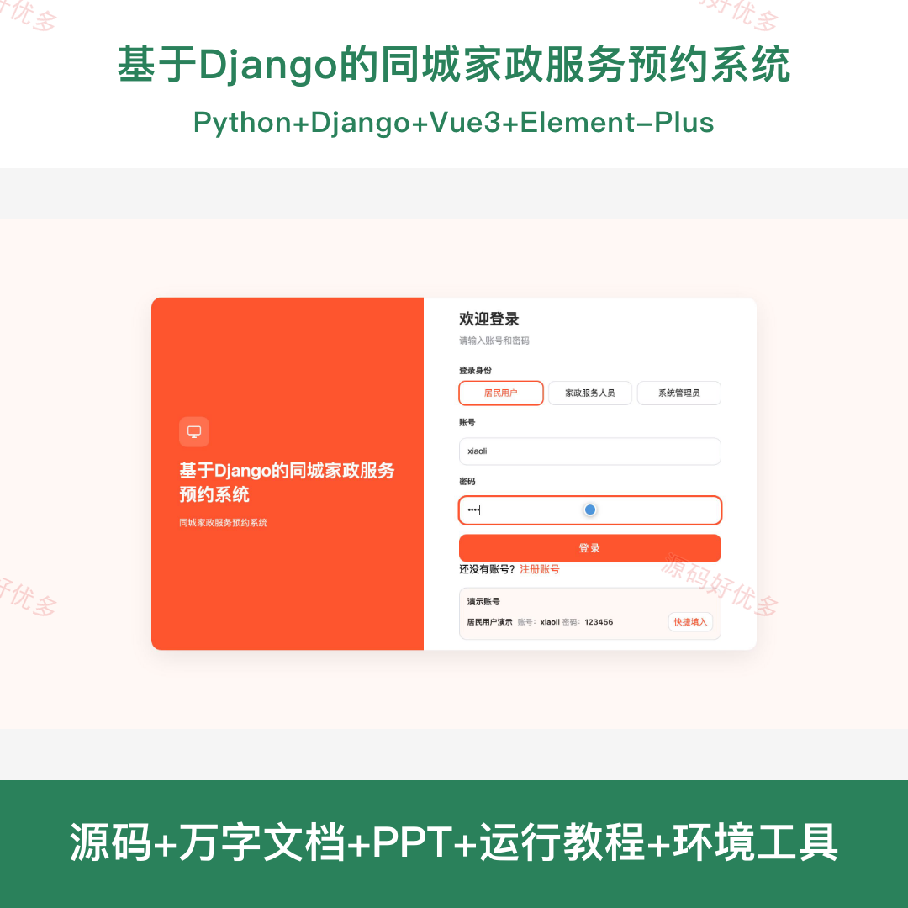
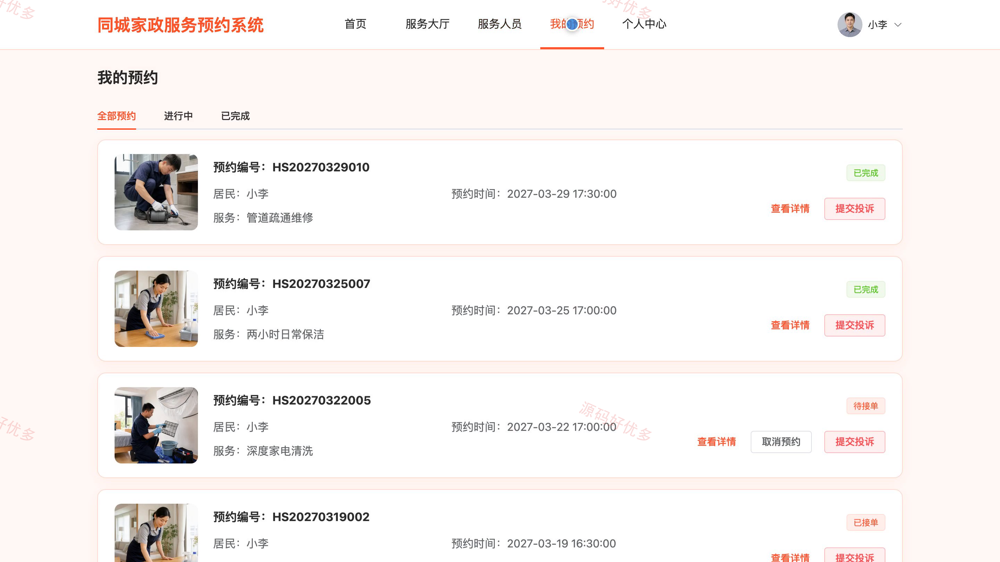
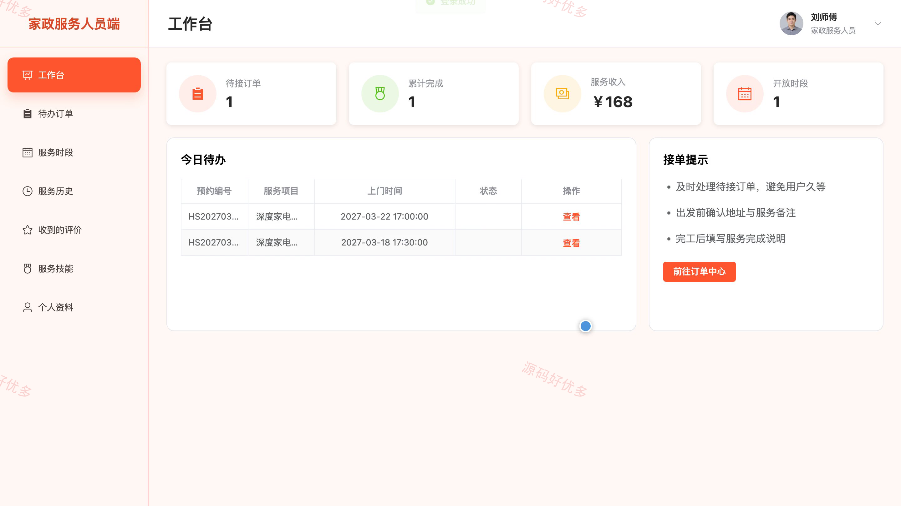
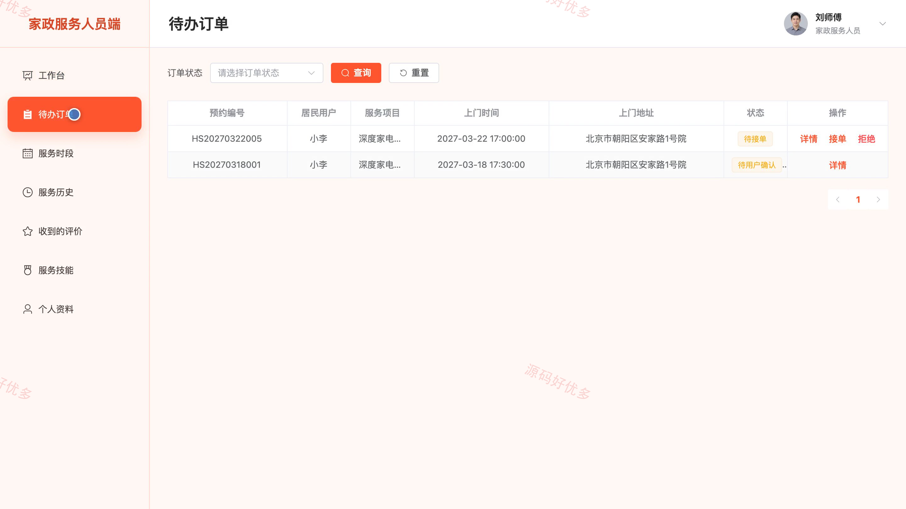
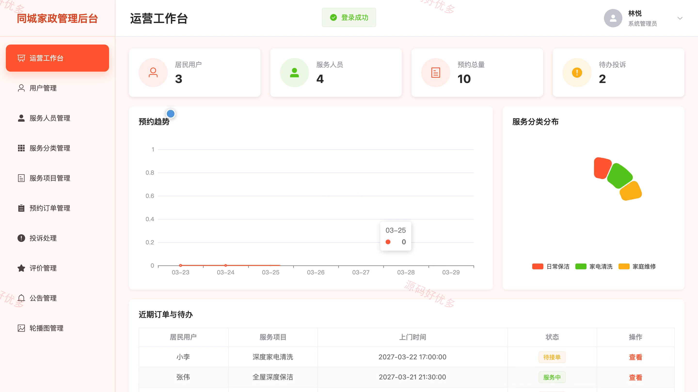
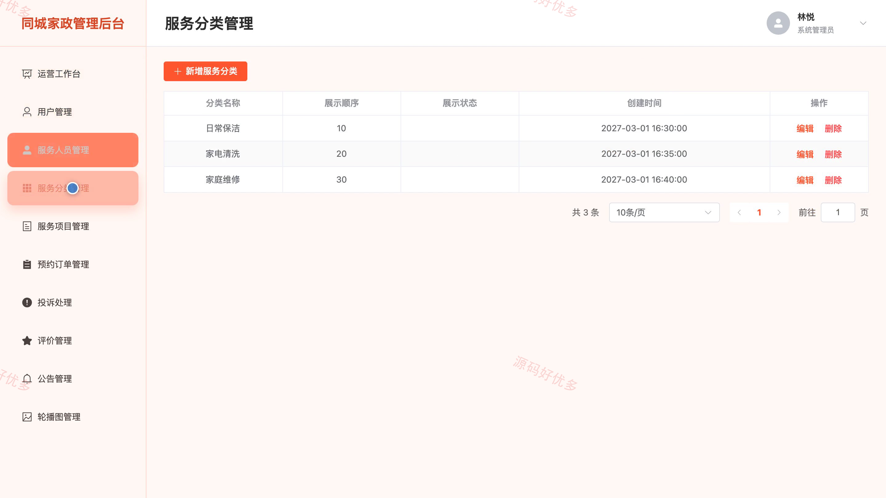

## 源码问题查看主页咨询

### 一、关键词
同城家政、家政预约、上门服务、服务人员、预约订单

### 二、作品包含
源码+数据库+万字设计文档+PPT+全套环境和工具资源+本地部署教程

### 三、项目技术
前端技术： Html、Css、Js、Vue3.4、Element-Plus
后端技术：Python、Django

### 四、运行环境要求
开发工具：PyCharm + VSCODE

数据库：MySQL5.7+（共15张表）

数据库管理工具：Navicat10以上版本

环境配置软件： Python3+

前端Nodejs：16+

浏览器：谷歌浏览器

### 五、项目介绍
项目编号：bs111C

基于Django的同城家政服务预约系统面向居民用户、家政服务人员和系统管理员，围绕家政服务查询、人员选择、上门时段预约、订单状态协同、服务评价与投诉处理开展业务，支持居民在线预约、服务人员接单履约和管理人员统一运营。

角色：居民用户、家政服务人员、系统管理员

居民用户功能：服务项目与人员浏览、可预约时段查询、家政服务预约、预约订单查看与取消、服务完成确认、服务评价、投诉反馈、个人资料与密码管理。

家政服务人员功能：工作台数据概览、待办预约接单与拒单、服务状态流转、可服务时段管理、服务历史查看、收到的评价查看、服务技能管理、个人资料维护。

系统管理员功能：运营数据统计、居民用户管理、服务人员审核与管理、服务分类管理、服务项目管理、预约订单管理、投诉与评价管理、公告与轮播图管理。

### 六、运行截图

